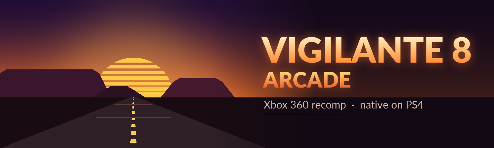

<p align="center">
  
</p>

<p align="center">
  
  
  
  
  <a href="LICENSE"></a>
  <a href="https://discord.gg/fqjMs9gDJh"></a>
</p>

<h3 align="center">Vigilante 8 Arcade, recompiled to run natively on the PS4.</h3>

<p align="center">
  <a href="#getting-started"><b>🛠 Build it yourself</b></a> ·
  <a href="#getting-started">Getting started</a> ·
  <a href="#controls">Controls</a> ·
  <a href="#the-quick-menu">Quick menu</a> ·
  <a href="#faq">FAQ</a> ·
  <a href="https://discord.gg/fqjMs9gDJh">Discord</a> ·
  <a href="CREDITS.md">Credits</a>
</p>

---

## Overview

This port brings [vig8](https://github.com/sp00nznet/vig8), sp00nznet's recompilation of the Xbox Live Arcade game
**Vigilante 8 Arcade** (Isopod Labs and Activision, 2008), to jailbroken PS4 consoles. There's no CPU emulator:
[ReXGlue](https://github.com/rexglue/rexglue-sdk) turns the PowerPC code of the game's `default.xex` into C++ on your
PC, and that code is compiled for the PS4's Jaguar CPU. The game's Xbox 360 GPU commands are drawn by the SDK's
Xenos layer (derived from [Xenia](https://xenia.jp)) on **Vulkan**, through Mesa's RADV driver adapted to the PS4's
AMD GPU.

The runtime is the PS4 SDK of [MP3-PS4](https://github.com/iHaiDeeZ/MP3-PS4) (the ReXGlue SDK with the
[MGR-PS4](https://github.com/iHaiDeeZ/MGR-PS4) platform layer), with this game's fixes on top.

It installs as an app on the home screen and plays with a DualShock 4. **L3 + R3** opens a quick menu for the
anti-aliasing, a frame counter, the achievements and the diagnostics.

**You bring your own game.** Nothing copyrighted is in this repository: no game code, art or sound, and no packages.
The package you build holds your game, so it's for your own console only.

## Highlights

**The whole game, natively**
- The game's PowerPC code recompiled ahead of time and built for the PS4's Jaguar cores: no interpreter, no JIT.
- MP3-PS4's speed passes on the generated code: guest registers as C++ locals, small helpers inlined, fused
  multiply-adds split for the Jaguar (it has no FMA unit).
- The **High Octane Pack** DLC, with its cars and arenas, goes into the package with the game.
- Sound at 48 kHz, with the game's XMA audio decoded by FFmpeg.
- **Achievements**: the quick menu lists them, a pop-up shows each unlock, and the game's own *Achievements* item
  opens that list. They're kept on the console.

**Made for the PS4's CPU**
- The Xenos command processor, the busiest part of the port, runs alone on the seventh core, and the game's threads
  are spread over the other six by how busy each one is.
- **One pass for the 3D scene (v00.10).** The original draws its scene with 4x MSAA, which doesn't fit the Xbox 360's
  10 MB of video memory at 720p, so it draws the whole scene four times, once per quarter of the screen. Here the
  scene is drawn once, with FXAA to smooth the edges. The original 4x MSAA is one menu setting away.
- Frames flip as soon as they're ready instead of waiting for the next 60 Hz tick, with the game's clock untouched.
- Shortcuts for the work the GPU layer repeats on every draw (render targets, shader loads, samplers).

**When something goes wrong**
- A log for every session, ps4-kit's boot trace and crash log in `/data/V8A/`.
- Diagnostics you can switch off in the menu: a freeze report with every thread's stack, a log of the game's long
  waits, CPU profiles (one starts by itself on the first slow stretch of a session), and the GPU driver's flight
  recorder for GPU crashes.

## Status

| | |
|---|---|
| Boots, menus, races | yes |
| Frame rate | menus 60. Races on a PS4 Pro in Boost Mode: 25 to 50 fps (v00.09), 15 to 25 in Farmland's busiest views (v00.08). v00.10 draws the scene once instead of four times: **not measured on a console yet** |
| Roads and bridges (tessellated) | yes, since v00.05 |
| High Octane Pack | yes, in the package |
| Achievements | yes, in the quick menu |
| Split-screen, online | not tested |
| Tested on | a PS4 Pro on firmware 14.00 with GoldHEN |

## Getting started

**You need:** a jailbroken PS4 with **GoldHEN** and an FTP connection to it; a PC with **WSL 2** (Ubuntu, 16 GB of
RAM, about 10 GB free); and your **own** copy of **Vigilante 8 Arcade** for Xbox 360: the package files your console
keeps in `Content/0000000000000000/584108A8/`, the game in `000D0000/` and, if you have it, the High Octane Pack in
`00000002/`.

Its `default.xex` must have SHA-1 `b6e91b2c4563ce04699570dfe168220f148c0968` (title `584108A8`): the code generator's
configuration is made for that file.

> **Note:** the build also needs **[ps4-kit](https://github.com/iHaiDeeZ/ps4-kit)** in `~/ps4-kit`, the shared PS4
> base of these ports (toolchain setup, runtime, Mesa RADV for the PS4, VideoOut swapchain, packaging). Two of the
> Mesa patches this port needs aren't in the published kit
> ([`79d173b`](https://github.com/iHaiDeeZ/ps4-kit/commit/79d173b)) yet, so they're in
> [`patches/mesa/`](patches/mesa): copy them into `~/ps4-kit/gpu/mesa-patches/` and build the kit's Mesa
> (`bash ~/ps4-kit/gpu/build-mesa.sh`) before the app. Without 0034, the first race ends the game.

### Building the package

1. Install the host tools in WSL (clang 21 from [apt.llvm.org](https://apt.llvm.org) if your Ubuntu doesn't have it):

   ```bash
   sudo apt install clang-21 lld-21 cmake ninja-build git rsync curl python3 python3-pil
   ```

2. Get the sources at the commits this port is built on, with its patches applied (into `~/vig8-build/src`):

   ```bash
   bash scripts/clone-vig8.sh
   ```

3. Copy your console's `584108A8` folder into this repository's folder (git leaves it out), then unpack the packages:

   ```bash
   python3 scripts/stfs-extract.py 584108A8/000D0000 ~/vig8-build/x-game
   ln -sfn ~/vig8-build/x-game/AB5401DD66BB4F43B9668C307DB47F449324963E58 ~/vig8-build/game
   python3 scripts/stfs-extract.py 584108A8/00000002 ~/vig8-build/dlc
   sha1sum ~/vig8-build/game/default.xex
   ```

   The third line is for the High Octane Pack; without it the package has the base game only.

4. Build, from this repository's folder in WSL:

   ```bash
   scripts/build-vig8.sh host
   scripts/build-vig8.sh codegen
   VIG8_VERSION=00.10 scripts/build-vig8.sh app
   VIG8_VERSION=00.10 scripts/build-vig8.sh pkg
   ```

   `host` builds the code generator, `codegen` writes the game's C++ from your `default.xex` (and applies the speed
   passes and the game fixes), `app` compiles the eboot (about 1.5 GB of RAM per compile job) and `pkg` makes
   **`out/V8A-v00.10.pkg`** (title ID `VIGA00001`, about 225 MB with your game and DLC inside).

5. Copy the package to the console (FTP to `/data/pkg`) and install it with GoldHEN's **Package Installer**.

> **Tip:** the package's icon and background are original art (`scripts/make-icon.py`). To use your own, put a
> 512x512 `icon0.png` and a 1920x1080 `pic1.png` in `sce_sys/local/`: the build takes them from there, and git leaves
> them out.

**Updating:** build the newer version and install it on top of the old one. Your saves, achievements and settings in
`/data/V8A/` stay.

## Controls

| DualShock 4 | Xbox 360 controller |
|---|---|
| Cross / Circle / Square / Triangle | A / B / X / Y |
| L1 / R1 | LB / RB |
| L2 / R2 | Left / right trigger |
| OPTIONS | Start |
| Touch pad click | Back |
| Left / right stick | Left / right stick |
| L3 / R3 | Stick buttons |
| D-pad | D-pad |
| **L3 + R3** | Open or close the quick menu |

## The quick menu

**L3 + R3** together while playing (again, or **Circle**, to close it). A panel slides in from the left. **L1 / R1**
change the tab, the D-pad moves, **Left / Right** change a setting and **Cross** picks. Changes apply at once, except
the ones marked "next start", and are saved to `/data/V8A/vig8.toml` when the menu closes. The game keeps running
behind the menu, with your pad held back from it: pause with **OPTIONS** first.

| Tab | Row | Choices |
|---|---|---|
| GAME | Unlock all cars | **Off**, On: every vehicle in the selection screen (next start) |
| | Anti-aliasing | **FXAA** (the scene drawn once), Off (once, no smoothing), 4x MSAA (the original: the scene drawn four times, far slower) |
| | Occlusion queries | **Fixed** (every object reported visible), GPU queries (slow; next start) |
| | Frame pacing | **Flip when ready**, Wait for the 60 Hz tick |
| | GPU shortcuts | **On**, Off: to check whether a picture problem comes from them |
| | GPU emulation core | **Core 6**, Alternate 6 / 2 (a speed test) |
| OVERLAY | Frame counter | **Off**, FPS, Detailed (frame times and a graph of the last 120 frames) |
| | Position | **Top left**, Top right |
| DIAGNOSTICS | Record a CPU profile | 8 s of play after the menu closes, every thread, to `/data/V8A/profiles/` |
| | Profile slow gameplay | **On**: once a session, after 15 s in a row under 25 fps, an 8 s profile and a GPU census |
| | Freeze report | **On**: every thread's stack to `hang.log` when no frame comes for 15 s |
| | Frame rate log | **On**: the frame rate in the log every 10 s |
| | Long-wait log | **On**: every 30 s, the game threads that have waited 2 s or more |
| | GPU fault recorder | **Off**, On: the GPU driver keeps the last frames' commands, for a GPU crash report (slower; next start) |
| ACHIEVEMENTS | Unlocked, Unlock pop-ups, the list | your achievements; pop-ups **On** |
| ABOUT | | the build, the game, the DLC, the CPU clock, the console |

The defaults are in bold.

## Your files

Everything sits in **`/data/V8A/`**:

- `vig8/584108A8/`: the Xbox 360 profile and your saves
- `vig8/achievements/`: your unlocked achievements
- `vig8/cache/`: the translated shaders
- `vig8.toml`: the settings (the quick menu writes it)
- `logs/vig8_NNN.log`: one log for every session
- `boot-trace.log`, `crash.log`, `hang.log`: ps4-kit's start-up trace, its crash record and the freeze report
- `profiles/`: the CPU profiles and GPU censuses
- `game/`: your unpacked game, only if your package doesn't carry it

## FAQ

**Why isn't there a package to download?**
The package holds code recompiled from the game and the game's own files. You build it from your own copy; this
repository is source only.

**Which version of the game works?**
The Xbox Live Arcade release with the `default.xex` named above, with or without the High Octane Pack.

**Why does it slow down in busy places?**
The Xbox 360's GPU commands are translated for Vulkan on one CPU core, one draw at a time, and the busiest views send
thousands of draws a frame. Before v00.10 every draw of the 3D scene was translated four times (see the overview). On
a PS4 Pro, turn on **Boost Mode** (Settings > System) for a 2.13 GHz CPU instead of 1.6.

**The edges look smoother on the Xbox 360.**
The original uses 4x MSAA, which costs the PS4 four times the work. Pick *4x MSAA* under *Anti-aliasing* in the quick
menu to see the original picture.

**How do I report a bug?**
On [Discord](https://discord.gg/fqjMs9gDJh) or in an [issue](https://github.com/iHaiDeeZ/Vigilante-8-Arcade-PS4/issues).
Attach the newest `logs/vig8_NNN.log`, `boot-trace.log` and, if there are any, `crash.log`, `hang.log` and the
files in `profiles/` from `/data/V8A/`, with the version, what you were doing, your PS4 model and firmware.

## How it works on the PS4

| Part | PS4 |
|---|---|
| Game code | ReXGlue v0.10.0's generator writes C++ from `default.xex` on your PC; MP3-PS4's passes speed it up; ps4-kit's clang 21 builds it for the Jaguar |
| Runtime | MP3-PS4's PS4 SDK: the 360 kernel and XAM on PS4 threads, direct memory and files, the game's threads spread over the cores every second |
| GPU | the SDK's Xenos command processor (Xenia's design) translates the game's command ring into Vulkan, on ps4-kit's RADV and VideoOut |
| Shaders | Xenos microcode translated to SPIR-V as the game loads them, cached in `/data/V8A/vig8/cache` |
| Sound | XMA decoded by FFmpeg, out through `sceAudioOut` at 48 kHz |
| Pad | `scePad` (DualShock 4); the same pad drives the menu through ImGui |
| Files | the game and the DLC read from the package (`/app0/game`, `/app0/content`); saves in `/data/V8A/vig8` |

Bugs found on the way that matter for other ports of this SDK (the whole story is in
[docs/DEVELOPMENT.md](docs/DEVELOPMENT.md)):

- **The tessellation factor ring.** The PS4 ignores an app's `VGT_TF_MEMORY_BASE`: the factor ring sits at the fixed
  address `0xFF0000000`, which the app must map itself. The game's first tessellated draw (the roads) faulted there
  and the system ended the app. ps4-kit's Mesa patch 0034 maps it.
- **Predicated tiling.** A 360 game that renders 720p with MSAA draws its scene once per EDRAM tile, and the GPU is
  meant to skip the draws outside each tile from screen extents it reports. The SDK reports the whole screen, as Xenia
  does, so every draw runs in every tile. This port changes the game's sample count to one, so one tile fits.
- **The vblank wait.** The game waits each frame for a flag its vblank interrupt clears. With the vblank on a fixed
  60 Hz clock the command processor sat out half a refresh on average; now a wait that hasn't matched brings the
  coming vblank forward, still one per 1/60 s.
- **A bug of the game itself.** The ray test against curved road patches subdivides with a 32-entry stack and no depth
  limit; an endless subdivision ran it through the thread's stack 20 minutes into a race. A codegen fix pushes only
  while an entry fits.

## Good to know

- v00.10's single-pass scene hasn't been measured on a console yet (see [Status](#status)).
- The game keeps running while the quick menu is open.
- Save in the game; there are no save states. Your saves carry over to new versions.
- On a PS4 Pro, use Boost Mode. The app can't switch on the Pro's own mode (the Mesa driver knows only the base GPU),
  so the Pro's extra speed comes from Boost Mode.

## Community

Join the **[Discord](https://discord.gg/fqjMs9gDJh)** for help, reports and news.

## Thanks

- **[sp00nznet](https://github.com/sp00nznet/vig8)**: vig8, the recompilation of Vigilante 8 Arcade this port builds on
- **[ReXGlue](https://github.com/rexglue/rexglue-sdk)** by Tom Clay, with portions from **[Xenia](https://xenia.jp)**:
  the static recompiler and the Xbox 360 runtime, and **[rexglue-sdk-nx](https://github.com/nx-mod/rexglue-sdk-nx)**
- The code generation passes of **gears2-nx** and **dantes-inferno-nx**, as MP3-PS4 carries them
- **[Mesa](https://mesa3d.org)**: the RADV Vulkan driver that draws every frame
- **[FFmpeg](https://ffmpeg.org)**: the XMA decoder
- **[Lato](https://www.latofonts.com)** by Łukasz Dziedzic: the quick menu's font
- **[OpenOrbis](https://github.com/OpenOrbis)** and **[PacBrew](https://github.com/PacBrew)**: the PS4 toolchains
- **GoldHEN**: the homebrew enabler the package runs under

Everyone involved, with licences, is listed in **[CREDITS.md](CREDITS.md)**. How the port is built and what it
changes: **[docs/DEVELOPMENT.md](docs/DEVELOPMENT.md)**.

## License and disclaimer

This repository is released under the **GNU GPL v3**, as the code generation passes it carries are. See
[LICENSE](LICENSE). The upstream files the patches change keep their own licences (MIT for vig8, BSD-3-Clause for
the ReXGlue SDK); see [CREDITS.md](CREDITS.md).

This is a fan-made project with no ties to Activision, Isopod Labs, Microsoft, Sony Interactive Entertainment or the
authors of the projects it builds on. Vigilante 8 belongs to its owners; Xbox 360 is a trademark of Microsoft;
PlayStation and PS4 are trademarks of Sony Interactive Entertainment. Please only play games you own. This project
won't help you find or share game files.
